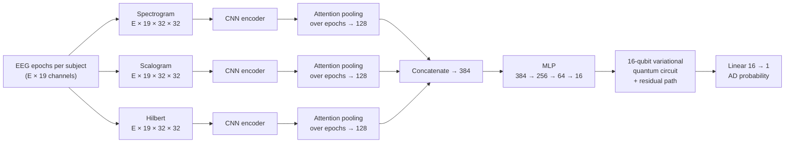

# HQ-EEGNet
### A Hybrid Quantum–Classical Deep Learning Pipeline for Alzheimer's Disease Detection from Resting-State EEG

**Author:** Prachi · MSc Computer Science, University of Delhi (2026)
**Supervisor:** Prof. Punam Bedi, University of Delhi
**Status:** Active research, manuscript in preparation · code shared for review only (see [Usage notice](#usage-notice))

---

## Overview

HQ-EEGNet classifies resting-state, eyes-closed EEG recordings as **Alzheimer's disease (AD)** or **cognitively normal (CN)**. It combines three complementary time–frequency views of the signal, a separate convolutional encoder for each view, and a **16-qubit variational quantum circuit** as the final feature-transformation stage before classification.

The project asks a focused question: *Can a parameterised quantum circuit, trained end-to-end inside a classical deep network, act as a useful learned feature map for a small, clinically realistic EEG dataset?* Small cohorts are typical in clinical neuroscience, and expressive yet low-parameter models are worth exploring in that regime.

**Highlights**

- End-to-end hybrid model in **PyTorch + PennyLane** with gradients flowing through the quantum circuit (backpropagation on a simulated device).
- **Multi-representation input:** STFT spectrogram, continuous-wavelet scalogram and Hilbert-transform features, computed per channel, per epoch.
- **Subject-level classification:** a variable number of epochs per subject is aggregated with masked **attention pooling**, so every prediction is about a person, not a segment.
- **Stratified 5-fold, subject-level cross-validation.** No subject appears in both the training and validation folds.

---

## Motivation

Alzheimer's disease changes the electrical rhythm of the brain in measurable ways, most consistently a shift of power from the alpha band towards slower delta and theta activity. EEG is inexpensive, non-invasive and widely available. That makes it attractive as a screening aid, especially where MRI or PET is out of reach.

Quantum machine learning offers a different kind of model: a small number of trainable rotation angles act on an exponentially large state space. Whether that helps on real biomedical data is an open question. This project builds and evaluates such a model honestly, end to end, on a public clinical dataset.

---

## Dataset

**OpenNeuro ds004504**: *A dataset of scalp EEG recordings of Alzheimer's disease, frontotemporal dementia and healthy subjects from routine EEG* (Miltiadous et al., 2023). Licence: CC0.

| Property | Value |
|---|---|
| Participants | 88 total: 36 AD, 23 FTD, 29 CN |
| Used in this work | **65 subjects (36 AD, 29 CN)**; FTD excluded for the binary task |
| Recording | Resting state, eyes closed, Nihon Kohden 2100 clinical system |
| Electrodes | 19 scalp channels, international 10–20 system (Fp1, Fp2, F7, F3, Fz, F4, F8, T3, C3, Cz, C4, T4, T5, P3, Pz, P4, T6, O1, O2) |
| Sampling rate | 500 Hz |
| Clinical scores | MMSE: AD 4–23, CN 30 |

---

## Preprocessing

Preprocessing happens in two stages: the cleaning the dataset authors applied to the published derivatives, then the steps implemented in this project.

### Stage A — Dataset derivatives (applied by the dataset authors)

HQ-EEGNet starts from the **preprocessed derivatives** released with ds004504. According to the dataset publication, these were produced by:

1. **Band-pass filtering:** Butterworth, 0.5–45 Hz.
2. **Re-referencing** to the average of the mastoid electrodes A1–A2.
3. **Artifact Subspace Reconstruction (ASR):** removal of bad data periods exceeding a 0.5 s-window standard-deviation threshold of 17.
4. **Independent Component Analysis** (RunICA, 19 components), with components automatically labelled by **ICLabel** as eye or jaw artifacts removed.

### Stage B — Project preprocessing (this work)

5. **Cohort selection:** loaded `participants.tsv`, kept AD (label 1) and CN (label 0) subjects, dropped FTD.
6. **Channel standardisation:** all recordings restricted to the same 19 channels in a fixed order.
7. **Downsampling to 64 Hz.** This reduces computational load while keeping the full clinically relevant band (Nyquist = 32 Hz, above the 30 Hz analysis ceiling).
8. **Epoching:** each continuous recording is segmented into fixed-length epochs. <!-- TODO: confirm epoch duration and overlap from the preprocessing script before publishing -->Subjects keep their natural number of epochs, which varies with recording length. These are not truncated, but padded and masked at batch time.
9. **Per-epoch, per-channel filtering:**
   - 50 Hz notch filter (IIR, Q = 30). It is guarded by a Nyquist check, so at 64 Hz it is bypassed and line noise is handled by the low-pass edge below.
   - **4th-order zero-phase Butterworth band-pass, 1–30 Hz** (`filtfilt`), covering the delta, theta, alpha and beta bands.
10. **Time–frequency transformation** of every filtered channel into three 32 × 32 images (next section).
11. **Per-image min–max normalisation** to [0, 1] after log-compression.
12. **Training-time augmentation only:** additive Gaussian noise (σ = 0.01) on all three representations, and random single-channel dropout (p = 0.2). Validation data is never augmented.

---

## Time–frequency representations

Each epoch yields, for each of the 19 channels, three complementary images:

| Representation | Method | Settings | What it captures |
|---|---|---|---|
| **Spectrogram** | Short-time Fourier transform (power spectral density) | Hamming window 1 s, hop 0.5 s, 1–30 Hz, log(1 + P) | Stable band-power structure over time |
| **Scalogram** | Continuous wavelet transform, Morlet wavelet | 32 scales mapped linearly to 30 → 1 Hz, log(1 + \|W\|²) | Multi-resolution, transient time–frequency activity |
| **Hilbert features** | Analytic signal via Hilbert transform | Log amplitude envelope and instantaneous frequency (clipped to 1–30 Hz), stacked | Moment-to-moment amplitude and phase dynamics |

All images are resized to **32 × 32**, so each epoch becomes three tensors of shape **19 × 32 × 32**, with channels as feature maps.

---

## Model architecture

### 1. CNN encoders (one per representation)

| Block | Layers |
|---|---|
| Conv block 1 | Conv2d(19 → 32, 3×3) · BatchNorm · GELU · MaxPool(2) |
| Conv block 2 | Conv2d(32 → 64, 3×3) · BatchNorm · GELU · MaxPool(2) |
| Conv block 3 | Conv2d(64 → 32, 3×3) · BatchNorm · GELU · AdaptiveAvgPool(1) |
| Projection | Linear(32 → 64) · GELU · Dropout(0.3) · Linear(64 → 128) |

### 2. Subject-level attention pooling

Each subject contributes a different number of epochs. A learned attention layer scores every epoch embedding, padded epochs are masked out (score set to −∞), and a softmax-weighted sum produces one 128-dimensional vector per representation. The model therefore learns which segments of a recording are most informative.

### 3. Classical fusion head

The three pooled vectors are concatenated (384-d) and compressed to 16 features, one per qubit, by an MLP: 384 → 256 (GELU, Dropout 0.4) → 64 (GELU) → 16.

### 4. Quantum layer

Implemented in **PennyLane** on the `default.qubit` simulator with `diff_method="backprop"`, so the circuit trains jointly with the CNNs.

| Component | Detail |
|---|---|
| Qubits | 16 |
| Input projection | Linear(16 → 16), clamped to [−π/2, π/2] |
| Encoding | Angle encoding: RY(xᵢ) followed by RZ(xᵢ / 2) on each qubit |
| Variational layers | 3 × [ Rot(φ, θ, ω) on every qubit → ring of CNOTs (i → i+1 mod 16) ] |
| Trainable circuit parameters | 3 layers × 16 qubits × 3 angles = **144** |
| Measurement | ⟨Z⟩ expectation on all 16 qubits |
| Post-processing | Learnable per-qubit scale and bias, plus a parallel classical residual Linear(16 → 16) |

The residual connection keeps gradients stable through the quantum layer early in training. It also lets the network learn how much to rely on the quantum transformation.

### 5. Output

Linear(16 → 1) gives a logit, and a sigmoid gives the probability of AD.

---

## Training

| Setting | Value |
|---|---|
| Optimiser | AdamW with three parameter groups |
| Learning rates | Classical layers 1e-3 (weight decay 1e-4) · quantum rotation angles **5e-2** (no weight decay) · quantum pre/post layers 1e-3 |
| Schedule | Cosine annealing to 1e-5 over 300 epochs |
| **Quantum warm-up** | Quantum parameters frozen for the first 10 epochs so the classical encoders stabilise before the circuit trains |
| Loss | 0.5 × label-smoothed BCE (ε = 0.1) + 0.5 × class-weighted BCE (pos_weight = N_neg / N_pos) |
| Regularisation | Dropout, weight decay, gradient clipping (max-norm 1.0), data augmentation |
| Batch size | 4 subjects (variable-length epoch sequences, padded and masked) |
| Reproducibility | Fixed seed (42) for PyTorch, NumPy and fold assignment |
| Hardware | CPU-only quantum simulation, about 38 s per epoch |

The separate, higher learning rate for the circuit angles and the warm-up phase were both introduced after observing vanishing and unstable gradients through the quantum layer in earlier versions.

---

## Evaluation protocol

- **Stratified 5-fold cross-validation at the subject level** (`StratifiedKFold`, shuffled, seed 42): 52 training and 13 validation subjects per fold, class ratio preserved.
- All epochs from a subject stay in the same fold, so there is **no leakage of a person's EEG between training and validation**.
- Metrics: accuracy, F1, sensitivity (AD recall) and specificity (CN recall), computed per subject.

---

## Development history

HQ-EEGNet is the result of several iterations, and the failures were as instructive as the successes:

1. **Classical baseline:** a two-stage CNN pipeline on spectrogram, scalogram and Hilbert–Huang images for three-class AD / FTD / CN classification. It established the multi-representation idea.
2. **Feature-based quantum classifiers:** handcrafted EEG features (band power, Hjorth parameters, spectral edge frequency, approximate entropy, inter-hemispheric coherence) reduced by PCA and classified with a variational quantum classifier and a quantum-kernel SVM.
3. **First end-to-end hybrid models:** CNN encoders feeding an 8-qubit circuit. Diagnosing these surfaced real engineering problems: numerical underflow from volt-scale EEG producing all-zero spectrograms, BatchNorm instability with tiny batches, vanishing gradients through the circuit, and sampling-rate mismatches in the time–frequency transforms.
4. **HQ-EEGNet (current):** subject-level attention pooling, a 16-qubit circuit with a residual path, separate quantum learning rates, a warm-up phase, and subject-level cross-validation.

Each version was audited for data leakage and evaluation errors.

---

## Repository contents

| File | Description |
|---|---|
| `HQ-EEGNet.ipynb` | Full HQ-EEGNet implementation: time–frequency feature extraction, dataset and padding logic, CNN encoders, quantum circuit, hybrid model, training loop and 5-fold subject-level cross-validation |
| `README.md` | This document |

Raw and processed EEG data are not included. The dataset is publicly available from OpenNeuro (ds004504).

---

## Tech stack

Python · PyTorch · PennyLane · MNE-Python · SciPy · PyWavelets · OpenCV · scikit-learn · NumPy

---

## Usage notice

This repository is shared **for review purposes only**, as part of academic and graduate applications. The work is unpublished and a manuscript is in preparation.

**© 2026 Prachi. All rights reserved.** No licence is granted to copy, modify, redistribute or reuse this code or its results. If you are interested in this work or would like to collaborate, please get in touch.

---

## References

1. Miltiadous, A., Tzimourta, K. D., Afrantou, T., Ioannidis, P., Grigoriadis, N., Tsalikakis, D. G., Angelidis, P., Tsipouras, M. G., Glavas, E., Giannakeas, N., & Tzallas, A. T. (2023). A dataset of scalp EEG recordings of Alzheimer's disease, frontotemporal dementia and healthy subjects from routine EEG. *Data*, 8(6), 95. https://doi.org/10.3390/data8060095
2. OpenNeuro dataset ds004504. https://openneuro.org/datasets/ds004504
3. Bergholm, V., et al. (2018). PennyLane: Automatic differentiation of hybrid quantum-classical computations. *arXiv:1811.04968*.
4. Schuld, M., Bocharov, A., Svore, K., & Wiebe, N. (2020). Circuit-centric quantum classifiers. *Physical Review A*, 101(3), 032308.

---

## Acknowledgements

Thanks to Prof. Punam Bedi for supervision, and to the authors of ds004504 for making their clinical EEG data openly available.
